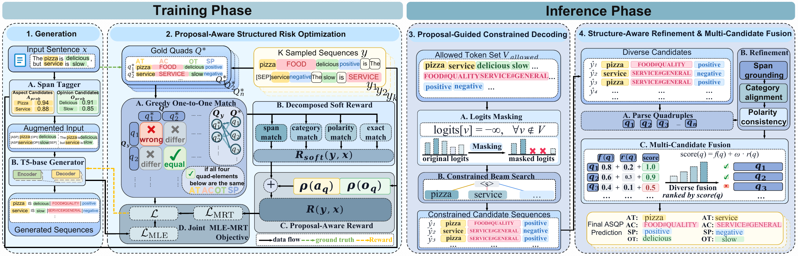

<div align="center">

# ProSCo

### Proposal-Guided Structured Risk Optimization<br>with Constrained Decoding for Aspect Sentiment Quad Prediction

**Span proposals connect what the model learns with what it is allowed to generate.**

<a href="https://github.com/Sterainding/ProSCo"></a>
<a href="#quick-start"></a>
<a href="#quick-start"></a>
<a href="#data"></a>

[Overview](#overview) · [Architecture](#architecture) · [Quick Start](#quick-start) · [Data](#data) · [Code](#code)

</div>

## Overview

Aspect sentiment quad prediction (ASQP) turns a review into a set of **aspect–category–sentiment–opinion** tuples. A fluent generated sentence is not enough: all four elements must agree, and the extracted spans must remain grounded in the review.

ProSCo explores a shared source of guidance for training and inference: **span proposals with confidence scores**. A lightweight tagger identifies candidate aspects and opinions. These proposals enrich the input and inform a structured sequence reward; at inference, they guide decoding, refinement, and candidate fusion.

| Proposal | Optimization | Prediction |
| :--- | :--- | :--- |
| Extract aspect and opinion candidates with confidence scores. | Combine span similarity, category agreement, polarity agreement, and exact tuple F1. | Use proposals to guide constrained generation and consolidate candidate quadruples. |

## Architecture

<p align="center">
  <a href="assets/pipeline.pdf"></a>
</p>
<p align="center"><em>Training and inference share the same span proposal signal.</em> · <a href="assets/pipeline.pdf">View the full-resolution PDF</a></p>

The framework has four stages:

1. **Proposal-augmented generation.** A span tagger supplies aspect and opinion candidates to a T5-base generator.
2. **Proposal-aware structured risk optimization.** Sampled sequences receive a decomposed tuple reward, with proposal confidence providing an additional grounding signal.
3. **Proposal-guided constrained decoding.** Candidate spans define guidance for the generation process.
4. **Refinement and fusion.** Structure-aware refinement (SAR) checks span grounding, category alignment, and polarity consistency; multi-candidate fusion (MCF) aggregates evidence across generated candidates.

## Quick Start

### Install

Use **Python 3.9** with a CUDA-compatible PyTorch installation. The supplied dependency versions target the original training stack.

```bash
conda create -n prosco python=3.9 -y
conda activate prosco
python -m pip install -r requirements.txt
```

### Prepare T5-base

Download the model once for local use:

```bash
cd T5-base
python get_model_offline.py
cd ../codes
```

This saves the model and tokenizer under `T5-base/t5-base-offline/`. The repository includes the download scripts; pretrained weights and caches are excluded.

### Train the span tagger

From `codes/`, train a tagger for the selected dataset using the included BIO annotations:

```bash
python train_ner.py --dataset Rest15 --epochs 5 --batch_size 16
```

The tagger is saved to `checkpoints/ner/Rest15/best_model/`. To regenerate BIO annotations after changing the source data, run `python build_ner_data.py`; this replaces the corresponding local BIO files.

### Run ProSCo

From `codes/`, use the following configuration to enable the proposal, reward, and inference modules:

```bash
CUDA_VISIBLE_DEVICES=0 python main.py \
  --task ProSCo --dataset Rest15 \
  --model_name_or_path ../T5-base/t5-base-offline \
  --batch_size 4 --max_seq_length 200 \
  --num_train_epochs 20 --learning_rate 3e-4 --seed 42 \
  --use_rag --use_ner_retrieval \
  --ner_model_path ../checkpoints/ner/Rest15/best_model \
  --use_mrt --mrt_start_epoch 10 --mrt_k 4 --mrt_temperature 0.8 \
  --use_soft_reward --use_retrieval_weighting \
  --use_constrained_decoding --use_sar --use_mcf \
  --output_dir ../outputs/prosco-rest15
```

The main entry point trains and then tests by default. These commands document the supplied configuration; this source release has not been validated through an end-to-end GPU run.

<details>
<summary><strong>Baseline, ablations, and checkpoint evaluation</strong></summary>

To inspect the base configuration, omit the proposal and risk-training switches:

```bash
CUDA_VISIBLE_DEVICES=0 python main.py \
  --task ProSCo --dataset Rest15 \
  --model_name_or_path ../T5-base/t5-base-offline \
  --batch_size 4 --num_train_epochs 20 --seed 42 \
  --output_dir ../outputs/base-rest15
```

For ablations, remove the relevant switch from the full configuration. Use a separate `--output_dir` for every setting: automatic subdirectory names do not encode all reward options.

| Switch | Component |
| :--- | :--- |
| `--use_rag` | Proposal-augmented input; without NER, candidates come from a vocabulary built on training labels |
| `--use_ner_retrieval` | Tagger-based aspect/opinion proposals and confidence scores |
| `--use_mrt` | Sequence-level risk optimization from `--mrt_start_epoch` |
| `--use_soft_reward` | Decomposed structured reward |
| `--use_retrieval_weighting` | Proposal-confidence reward weighting |
| `--use_constrained_decoding` | Proposal-guided decoding processor |
| `--use_sar` | Structure-aware refinement |
| `--use_mcf` | Multi-candidate fusion |

To evaluate a saved checkpoint, keep the training configuration and add:

```text
--do_train False --do_infer True --checkpoint_path /path/to/model.ckpt
```

The model, vocabulary, and enabled modules must match the checkpoint. The main outputs are `final_model.ckpt`, `results-<dataset>.json`, and, when risk-training records are available, `mrt_reward_log.json`.

</details>

## Data

Four ASQP datasets are included, along with their BIO annotations. The counts below refer to the ordinary `train.txt`, `dev.txt`, and `test.txt` files in this release.

| Dataset | Domain | Train | Dev | Test |
| :--- | :--- | ---: | ---: | ---: |
| Rest15 | Restaurant | 834 | 209 | 537 |
| Rest16 | Restaurant | 1,264 | 316 | 544 |
| Restaurant | Restaurant | 2,752 | 171 | 583 |
| Laptop | Laptop | 2,934 | 326 | 816 |

Each line stores a review and a list of tuples in **`(aspect, category, sentiment, opinion)`** order:

```text
the pizza is good####[('pizza', 'FOOD#QUALITY', 'positive', 'good')]
```

This is a synthetic format example. Sentiment labels are `positive`, `negative`, or `neutral`; implicit elements use `NULL`. Category mappings are defined in [`codes/category_mappings.json`](codes/category_mappings.json).

`data/Restaurant/` also retains the supplied `filter_*.txt` variants. They are separate files and are not selected automatically by the main entry point. BIO annotations are under `data/ner/<dataset>/`.

## Code

```text
ProSCo/
├── codes/                     # Model, training, evaluation, and span tagger
│   ├── main.py                # Experiment entry point
│   ├── model_prosco.py        # Generator, rewards, and risk optimization
│   ├── data_utils.py          # Data loading and proposal-augmented inputs
│   ├── sar.py                 # Structure-aware refinement
│   ├── mcf.py                 # Multi-candidate fusion
│   └── ...
├── data/                      # Four datasets, BIO labels, and filtered variants
├── T5-base/                   # Python download utilities; no model weights
├── assets/                    # Framework figure and README badges
├── requirements.txt
└── README.md
```

`codes/`, `data/`, and `T5-base/` are siblings. Run the training and evaluation scripts from `codes/` so their relative data paths resolve correctly.

## Acknowledgements

This implementation builds on the GDP code family associated with [*Pinpointing Diffusion Grid Noise to Enhance Aspect Sentiment Quad Prediction*](https://aclanthology.org/2024.findings-acl.222/) (Findings of ACL 2024). We acknowledge the underlying work and the dataset and pretrained-model contributors.
